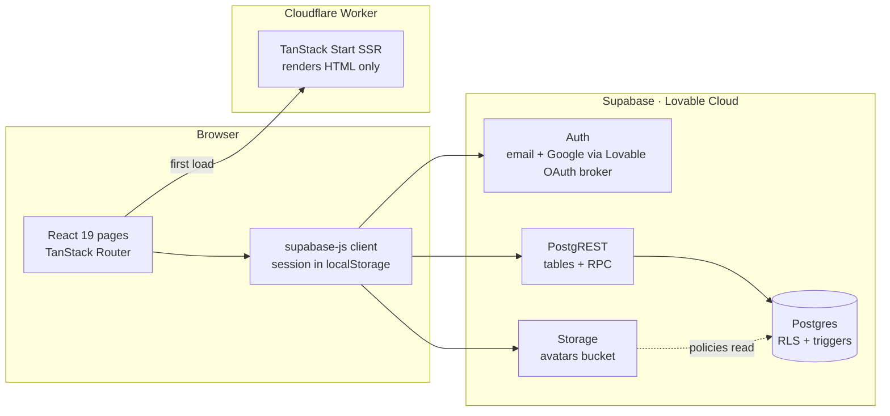
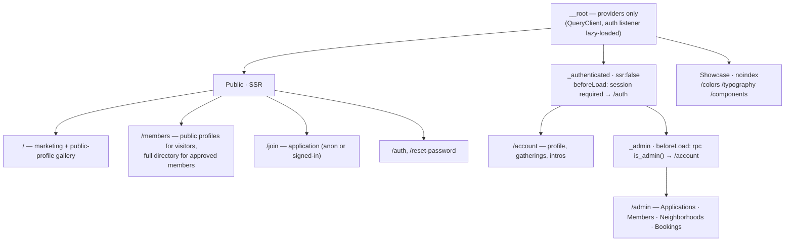
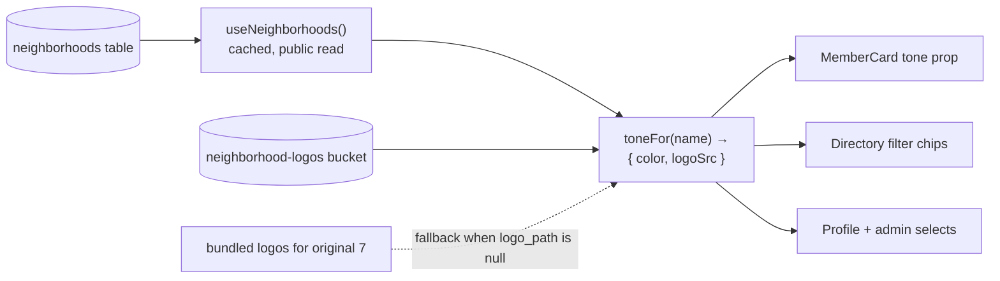
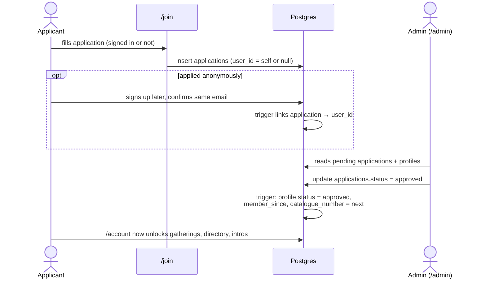

# Architecture — The Women’s Collective

Status: 2026-11-08. Part 1 describes the system as audited on 2026-11-07 (kept as the baseline; Phases 1–7 have since fixed what §1.5 lists), Part 2 the target architecture, and Part 3 how to get from one to the other.
Task numbers like **T10** refer to [AUDIT-TASKS.md](AUDIT-TASKS.md).

---

## Part 1 — Current architecture

### 1.1 Runtime topology



**Key fact:** the app has **no server code**. The Worker only renders HTML. Every read and write goes from the browser straight to Supabase with the publishable key, so **Postgres row-level security (RLS) and triggers are the entire security boundary**. Server helpers exist (`client.server.ts`, `auth-middleware.ts`, `cron-auth.ts`) but nothing imports them.

### 1.2 Source layout

| Layer | Path | Role | Health |
|---|---|---|---|
| Design system | `src/design-system/` + barrel `src/index.ts` | Tokens (`theme.css`), ~40 components, effects (WebGL gallery, trails, glow) | Good API, but breaks its own isolation rule (fonts outside, demo data and founder photo inside) |
| Routes | `src/routes/` | Pages: marketing, directory, auth, account | Pages fetch data in `useEffect`, map rows to UI and hold business rules |
| Showcase | `src/showcase/` | `Shell` toolbar, specimens, **the real join form** | Preview-only by rule, but used by live pages |
| App helpers | `src/lib/account.ts` | Neighborhood list, avatar URLs, initials | No clear home |
| Integrations | `src/integrations/` | Generated Supabase/Lovable clients and types | Don't hand-edit (types are regenerated) |
| Database | `drizzle/migrations/*.sql` | Hand-written SQL; Drizzle is only the runner | `schema.ts` is empty, so `drizzle-kit push` is dangerous |
| Lovable tooling | `mockupPreviewPlugin.ts`, `/__mockup`, `/__component` | Canvas previews in the Lovable editor | Leave alone |

### 1.3 Data model (after migrations 0001–0004)

```mermaid
erDiagram
  AUTH_USERS ||--|| PROFILES : "id (cascade)"
  AUTH_USERS ||--o{ USER_ROLES : "user_id (cascade)"
  AUTH_USERS ||--o{ APPLICATIONS : "user_id (set null), linked on email confirm"
  AUTH_USERS ||--o{ EVENT_RSVPS : cascade
  AUTH_USERS ||--o| HEADSHOT_BOOKINGS : cascade
  NEIGHBORHOODS ||--o{ PROFILES : "name (on update cascade)"
  NEIGHBORHOODS ||--o{ EVENTS : "name (on update cascade)"
  EVENTS ||--o{ EVENT_RSVPS : cascade

  PROFILES { uuid id PK; text full_name; text neighborhood "FK, nullable (0004)"; membership_status status "admin-only"; int catalogue_number "admin-only"; timestamptz member_since "admin-only"; bool directory_visible; text avatar_path "own folder only" }
  NEIGHBORHOODS { text slug PK; text name UK; text color "#rrggbb"; text logo_path; int sort_order; bool active }
  APPLICATIONS { uuid id PK; uuid user_id FK; text email; text full_name; text neighborhood "free text"; jsonb answers; membership_status status; timestamptz reviewed_at }
  USER_ROLES { uuid user_id; app_role role "admin | member" }
  EVENTS { uuid id PK; text title; text neighborhood FK; timestamptz starts_at }
  HEADSHOT_BOOKINGS { uuid user_id UK; date preferred_date; text status "requested | confirmed | declined" }
```

### 1.4 Access model (enforced in Postgres, verified by `drizzle/test/run.sh`)

| Who | Directory | Portraits | Events / RSVP / booking | Applications | Neighborhoods |
|---|---|---|---|---|---|
| Anonymous | public-profile members only *(Phase 2)* | public-profile members only *(Phase 2)* | ✗ | insert only (unlinked) | read |
| Pending or declined member | ✗ (empty) | own only | ✗ | insert (own) and read own | read |
| Approved member | approved + visible members | own, plus approved + visible members | ✓ (status always `requested`) | insert (own) and read own | read |
| Admin | everyone | everyone | everything, can confirm | read + review in `/admin` (`reviewed_by` recorded) | full control + logo upload |

Fields guarded by triggers:
- `profiles.status`, `catalogue_number` and `member_since` are admin-only.
- `headshot_bookings.status` resets to `requested` whenever a member writes the booking.
- Reviewing an application updates the linked profile, which then receives `member_since` and a catalogue number. `applications.reviewed_at`/`reviewed_by` are set only by that status change (0003).
- An admin approving or declining a profile directly gives the user's newest application the same status, `reviewed_at` and `reviewed_by` (0004). Only a top-level admin update syncs (`pg_trigger_depth() = 1`), so an application review never echoes back.

### 1.5 What was wrong with the audited shape (all fixed in Phases 1–7)

1. **Business rules live in page components.** Mapping database rows to cards, ranking introductions and formatting catalogue numbers are repeated across `members.tsx`, `account.tsx` and `member-card.tsx` (T10, T18).
2. **The data layer is hand-written.** React Query is installed but every read is `useEffect` + `useState`, and errors are swallowed (T8, T9, T18).
3. **Neighborhood data is compiled in.** Neighborhoods are typed as plain strings and duplicated in about 8 places as Tailwind class maps, which a database-driven list can't feed (T11).
4. **Showcase and app are mixed.** Live pages render the design-system toolbar, and the real join form sits in `src/showcase/` (T1, T16).
5. **Supabase loads on every page.** It's imported in `__root.tsx`, giving a 585 kB main chunk even on the marketing site (T30).
6. **No quality gate.** Lint is red, and there are no typecheck or test scripts and no CI (T33).

---

## Part 2 — Target architecture

### 2.1 Principles

1. **The database is the authority.** Every rule that protects a person (who sees what, who approves whom) is a policy or trigger with a test in `drizzle/test/rls.sql`. UI checks only shape the experience.
2. **The design system knows nothing about the app.** It takes colors, logos and members as props. It never imports Supabase, routes or domain data.
3. **Features own their data.** Each domain gets one module containing queries, mutations, types and row→view mappers. Routes compose features; they never call Supabase directly.
4. **Public pages stay light.** Supabase and auth code load only on routes that need them.
5. **No server functions until a secret is needed.** The current direct-to-Supabase model is correct for this app. Add TanStack Start server functions only for things that need secrets (emails, CAPTCHA verification, admin bulk operations).

### 2.2 Target source layout

```
src/
  design-system/            # attachable package — zero imports from outside this folder
    styles/theme.css        # tokens + fonts (fonts move here: assets/fonts/)
    components/             # MemberCard takes `tone={{ color, logoSrc }}`, not neighborhood names
    assets/                 # brand-only assets (logos, trail flowers)
  index.ts                  # barrel: the ONLY import path for app code (ESLint-enforced)

  features/                 # app domain — one folder per concept
    neighborhoods/          # queries.ts (useNeighborhoods), tone.ts (name → {color, logoSrc}), types.ts
    members/                # queries.ts (directory, profile), mutations.ts (save, avatar), map.ts (row → MemberProfile)
    applications/           # mutations.ts (submit), schema.ts (answers shape), queries.ts (admin list)
    events/                 # queries.ts, mutations.ts (rsvp), bookings.ts
    admin/                  # queries + mutations for review
    account/                # /account sections (header, card form, gatherings, headshot, intros), each owning its queries
  app/
    supabase.ts             # lazy getter: `await getSupabase()` → dynamic import of the client
    layout/                 # AppLayout.tsx: AppPage, AppNav (router Links + mobile menu), AppFooter; StatusPages.tsx: NotFound, ErrorPage
  routes/                   # thin: loader → feature query, component → feature + design system
  showcase/                 # specimens, Shell, demo members (moved here) — dev/noindex only
```

### 2.3 Route map and guards



- `/members` stays a public route with two audiences (§2.10):
  - visitors and pending members see only public profiles, plus "Sign in to see the full directory";
  - approved members see every listed member.
- The `_admin` route guard is only for user experience; the actual security is the `is_admin()` checks in the database.
- Keep `/` server-rendered. Its gallery reads only public profiles.

### 2.10 Public profiles (opt-in, Phase 2)

A third visibility level, layered on top of the members-only directory:

| Profile state | Visible to |
|---|---|
| hidden (`directory_visible = false`) | herself and admins |
| listed (`directory_visible`) | + approved members |
| public (`directory_visible and public_profile`) | + anyone, on the homepage gallery and the public `/members` |

- **Database: migration `0002_public_profiles.sql`.**
  - Add the column `profiles.public_profile boolean not null default false`. The member controls it, and it only takes effect while she is approved **and** listed. Hiding from the directory also takes her off the public site, with nothing to clean up.
  - `public_profiles()` is a function that runs with elevated rights and can be called by anonymous visitors. It returns only the public card fields (name, role, business, neighborhood, specialty, bio, looking-for, website, portrait path, catalogue number) and **no `id`**, so the catalogue number is the list key.
  - The `"Avatar read"` rule also lets **anonymous visitors** read portraits whose owner is approved, listed and public.
  - Add checks to `rls.sql`:
    - anonymous visitors see only public profiles and their portraits;
    - switching off `directory_visible` or `public_profile` removes both;
    - pending members never appear publicly even if the switch is on.
- **UI.**
  - On the account page, add a switch "Show my profile on the public website" under the directory switch. It's disabled while not listed, and its copy says clearly that anyone on the internet can see the card.
  - Home gallery: uses `public_profiles()`. If no one has opted in, it shows the section without the gallery (no demo people).
  - `/members` shows `public_profiles()` for visitors and `public_directory()` for approved members, with a sign-in prompt for the rest.
- **Later.** The application form asks for publication consent field by field, but this design uses one switch for the whole card. If per-field consent is needed, store a `public_fields text[]` and filter the columns in `public_profiles()`.

### 2.4 Data layer pattern

Each feature exposes `queryOptions` (for route loaders and components) and `useMutation` hooks. That gives one cache, loading and error states everywhere, and invalidation when something changes.

```ts
// features/members/queries.ts
export const directoryQuery = queryOptions({
  queryKey: ["directory"],
  queryFn: async () => {
    const { data, error } = await (await getSupabase()).rpc("public_directory");
    if (error) throw error;             // surfaces in the route's errorComponent — never swallowed
    return data.map(toMemberProfile);   // one mapper, used by directory, intros, admin
  },
});

// routes/_authenticated/members.tsx
loader: ({ context }) => context.queryClient.ensureQueryData(directoryQuery),
```

- The root auth listener already calls `queryClient.invalidateQueries()` on sign-in and sign-out, so once queries exist that wiring starts working.
- Mutations invalidate their keys. For example, saving a profile invalidates `["profile", id]` and `["directory"]`.

### 2.5 Neighborhoods as content



- **Colors.** Tailwind can't generate classes for colors that only exist in the database. So components set one CSS variable inline (`style={{ "--hood": color }}`) and use static utilities: `bg-(--hood)`, `text-(--hood)`, `border-(--hood)`.
  - This is the single sanctioned exception to "no inline styles". Add it to `.lovable/system.md`.
  - It replaces `catalogueTones`, `wash`, `ink`, `neighborhoodFill` and the color part of `brand.tsx`'s logo map.
- **Logos.** Admins upload a PNG or WebP to `neighborhood-logos/<slug>.png`. The original seven fall back to the bundled assets, so nothing has to be uploaded on day one.
- **Removing a neighborhood.** Set `active = false`. The database blocks deletion while profiles or events still use it, and renames carry through to every row automatically.
- **Contrast.** Store an `ink` color alongside `color`, or compute it client-side, so text on light neighborhood colors (Elmhurst, Forest Hills) stays readable (T26).

### 2.6 Membership lifecycle



- **An approved applicant with no account yet.** The application stays approved and unlinked. On her first confirmed sign-up, the link trigger attaches it and her profile takes the approval.
  - ~~Gap to close in a follow-up migration~~ **Closed by 0003:** `link_applications()` now gives a still-pending profile the outcome of an already reviewed application (approved wins over declined), fires after the profile exists (so OAuth sign-ups work too), and a one-time backfill fixed accounts linked under the old trigger order.
- **Approving from the Members tab.** Admins can approve or decline a profile directly; if she has applications, the newest one takes the same decision and records the admin (0004). Members with no application are simply approved.
- **Notifications (later).** Applicants currently learn nothing automatically. Add a database webhook or Edge Function that emails on `applications.status` change. That's the first legitimate need for a server-side secret.

### 2.7 Admin

- **One route, four tabs:**
  - **Applications:** pending first, with answers rendered from the `answers` JSON and approve/decline actions.
  - **Members:** every profile, with status, visibility and catalogue number.
  - **Neighborhoods:** add or edit name, color, logo and sort order (slug is fixed once created); activate or deactivate.
  - **Bookings:** confirm or decline.
- **Bootstrapping the first admin:** run once in the Lovable Cloud / Supabase SQL editor; step by step in [README.md](README.md#first-admin).
- **Audit trail** ✅ (0003). `applications.reviewed_by` is set from `auth.uid()` by the review trigger and can't be written directly; the Applications tab shows it.
- **Data access.** No admin RPC: admins already read all profiles and applications under RLS, so `features/admin` joins them client-side.

### 2.8 Build, delivery and quality

| Concern | Target |
|---|---|
| Scripts | `typecheck` (`tsc --noEmit`), `lint`, `test:db` (`drizzle/test/run.sh`), `check` = all three + `build` |
| CI | GitHub Action on pull requests and non-`main` pushes: the `check` steps (typecheck, lint, test, build) plus `test:db` against a Postgres `services:` container |
| Migrations | Hand-written SQL in `drizzle/migrations/` + journal entry; never `drizzle-kit push` (empty schema). Every policy change adds a check to `rls.sql` |
| Types | `src/integrations/supabase/types.ts` regenerated by Lovable after each migration. Hand-patching is allowed only as a bridge until then |
| Bundle | Supabase lazy-loaded (`app/supabase.ts`); WebGL gallery and image trail loaded client-only; fonts as subset WOFF2; images with `srcset` |
| Deploy | Cloudflare Worker with project-specific name (owner decision), secrets via Wrangler (never `.env`, guarded by `src/app/secrets.test.ts`), security headers on pages and server-function responses via `src/start.ts` request middleware (static assets come from the assets binding without them; CSP `frame-ancestors` limited to the site and the Lovable editor, which must frame it) |
| Docs | `README.md` (how to run), `ARCHITECTURE.md` (this file), `AGENTS.md` (rules for agents), `.lovable/system.md` (design rules); each states only what's true |

### 2.9 What stays as it is

- **TanStack Start, Supabase and Cloudflare:** they fit a small community site. No backend service or ORM layer is needed.
- **The design system's API style:** CVA variants, `forwardRef`, and dark sections done by re-pointing tokens (the `tone-night` trick).
- **Lovable's generated integration files and preview routes.**

---

## Part 3 — Migration path

| Phase | Outcome | Tasks | Notes |
|---|---|---|---|
| **0. Database** ✅ written | Members-only, approval enforced, neighborhoods/applications schema, 27 RLS checks green | T2–T7 | `0001_members_only_admin.sql`. Not yet applied to the live DB |
| **1. Foundations** | `features/` + `app/` folders, lazy Supabase, `useNeighborhoods`, `MemberCard` `tone` prop, types regenerated | T11, T18, T19, T30 | Makes phases 2–3 small |
| **2. Member flows** ✅ code + 0002 written (2026-11-08) | Migration 0002 public profiles + apply 0001/0002 live; `/members` and home gallery split public vs members, real catalogue numbers, no demo data; public-profile switch; account error states; RSVP/booking/avatar errors handled; timezone fixes | T8–T10, T12–T15, §2.10 | Ship migration and code together. 0001 + 0002 not yet applied live |
| **3. Applications + admin** ✅ code + 0003 written (2026-11-08) | `/join` saves (anonymous or signed-in), form `name`s and validation; `/admin` with four tabs | T1, T20 + new | Migration 0003: "approved before sign-up" fix, `reviewed_by`. Ship with 0001–0003 applied live (README). Still open: CAPTCHA/rate limiting for anonymous applications, review emails |
| **4. Site shell** ✅ code (2026-11-08) | App layout (no showcase toolbar), router-aware nav + mobile menu, 404/error pages, noindex showcase | T16, T17, T32 + T22 | `src/app/layout/` (`AppLayout.tsx`, `StatusPages.tsx`), `src/app/seo.ts`, `public/robots.txt`. Optional `VITE_SITE_URL` enables canonical and OG URLs. Still open: sitemap, menu click-outside |
| **5. Polish** ✅ code (2026-11-08) | Contrast, motion/a11y, WebGL/trail/font/image performance | T23–T29, T31 | Contrast asserted against `theme.css` tokens (`src/app/contrast.test.tsx`); new `--bl-sky-strong`, `ink-faint` `#92928d` (visual-change list in AUDIT-TASKS Progress → Phase 5). Skip link + `<main id="main">`, `useRouteFocus`, inert mobile menu. Client-only WebP trail, paused WebGL loop, subset WOFF2 + preload, WebP `srcset` (`src/app/responsive-images.ts`) |
| **6. Tooling** ✅ code (2026-11-08) | Lint green, scripts, CI, dependencies, `.env` and secrets, docs | T21, T33–T38 | ESLint 0/0; exact pins, `seroval` fixed (`bun audit` 69 → 29, all build/dev tooling); native tsconfig paths; `test:db`; `.github/workflows/check.yml` (app job + `postgres:17` RLS job); `.env` kept tracked with a secret-guard test; security headers via `src/start.ts` (CSP `frame-ancestors` allows the Lovable editor). Worker name/`compatibility_date`, full CSP and live migrations are owner decisions (AUDIT-TASKS.md) |
| **7. Cleanup** ✅ code + 0004 written (2026-11-08) | Every audit task done or won't fix; portrait-less cards show initials; catalogue cards open a member profile dialog; `account.tsx` split into `src/features/account/`; CurvedLoop rings stop after 5 s | T10, T11, T13, T18 + T2–T7, T12, T19, T30 ticked | `0004_cleanup.sql`: nullable `profiles.neighborhood` (no LIC default), profile → newest application sync (102 RLS checks). `MemberDialog` (native modal `<dialog>`) and `MemberCard` `onOpen`. Apply 0001–0004 live (README go-live order). New UI listed for owner review in AUDIT-TASKS Progress → Phase 7 |

**Resolved 2026-11-08:** public pages show only members who opt in (§2.10). Everything else stays members-only.
